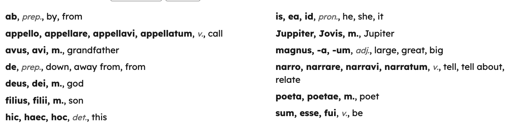

The Annual Meeting of the Classical Association of the Atlantic States (CAAS2026) took place on October 9 and 10 at the Hotel Du Pont in Wilmington, DE. My contribution to the program was a workshop on "Automating Vocabulary List Production." The abstract can be found [here](https://diyclassics.github.io/automating/). The goal of the workshop was twofold. First, I wanted to offer a basic tutorial to a newly released [LatinCy Vocab](https://github.com/latincy/latincy-vocab) package. But what I was really interested in doing with the workshop format was to introduce participants to all of the natural language processing, information retrieval, and data science techniques that go into creating a publication-ready vocabulary list with LatinCy Vocab.

As described in this earlier [post](https://exploratoryphilology.org/posts/introducing-latincy-vocab/), LatinCy Vocab can be set up so that, with only a plaintext passage of Latin, you can click a button, so to speak, and generate a vocabulary list like the one shown in @fig-vocabulary-list.

{#fig-vocabulary-list fig-alt="LatinCy Vocab list based on the opening sentences of *Ritchie's Fabulae Faciles*, including entries for ab, appello, avus, etc."}

But behind the scenes a lot of annotation and transformation work is happening to convert that plaintext passage into a formatted list. We see NLP processes like tokenization, normalization, lemmatization, part-of-speech and morphological tagging, named entity recognition and linking, and more. On the information retrieval and text analysis side, we see keyness measures like [tf-idf](https://en.wikipedia.org/wiki/Tf%E2%80%93idf) (i.e. why is this specific word important to gloss for this specific passage?) and lexicon-based filtering (i.e. should we include this word from the [DCC Latin Core Vocabulary](https://dcc.dickinson.edu/latin-core-list1)?) And then there are still the formatting and assembly tasks that, for example, make verbs look one way (e.g., **appello, appellare, appellavi, appellatum**, *v.*, call) and nouns another (e.g., **filius, filii**, *m.*, son) or that alphabetize the lists. During the workshop, I could work step-by-step through this vocabulary-building pipeline, giving participants a crash-course introduction to each component along the way.

It is worth mentioning that in the end it wasn't just a successful workshop. It basically turned into *two* back-to-back successful workshops. Learning that morning that several people who were interested in the workshop could not attend because of a scheduling conflict with the Teaching and Pedagogy paper session, I pivoted and decided to offer an abbreviated (and accelerated!) version of the workshop immediately following the first. This allowed the Teaching and Pedagogy presenters and audience to learn about LatinCy Vocab and its NLP underpinnings. And so, as it turned out, we avoided the kind of inevitable if disappointing situation that often arises with conference scheduling. Over 25 CAAS attendees were able to take part in one of the two workshops.

The conference was of course more than the workshop. Two events stand out, specifically because of links to other *Exploratory Philology*-adjacent research projects. The first was this year's Clack Lecture from [Irene Peirano Garrison](https://peiranogarrison.scholars.harvard.edu/) called "*Bellum Grammaticale*: Paths Not Taken in the History of the Latin Classroom and Why They Matter Today." The talk toured the last few centuries of Latin textbooks and curricula for trends in what has received attention and what has not, and so provided new critical perspectives on the history of Latin pedagogy for my *How To Read Latin Like a Computer* work to consider. The second was a paper by [Erin M. Hanses](https://cams.la.psu.edu/people/exm414/) in the Latin Poetry paper session that, through a phenomenological reading of women's health and sickness in Latin poetry, asked the audience to recenter Sulpicia in her relationship to the other elegists, Ovid in particular. Considering recent [Representing Women Authorship in the Latin Treebanks](https://diyclassics.github.io/rwalt-site/) work and that project's plan to publish soon an annotated dataset of Sulpicia's elegies, the recentering argument caught my attention.

I have been attending CAAS for over a decade now and it strikes me that it has long been a welcome venue for the intersection of my computational and pedagogical interests. In 2017, John Muccigrosso and I organized a CAAS panel called "Digital Approaches to Latin Vocabulary Acquisition," and in 2024, I presented the paper ["The Collocations You *Really* Need to Know"](https://diyclassics.github.io/collocations/), on statistical methods for choosing multiword expressions like *res publica* and *quam ob rem* for vocabulary lists. Feedback from Friday's workshop suggests there is interest in more of these kinds of computational-pedagogical explainers—let's see what comes together for next year's CAAS meeting in Philadelphia.
