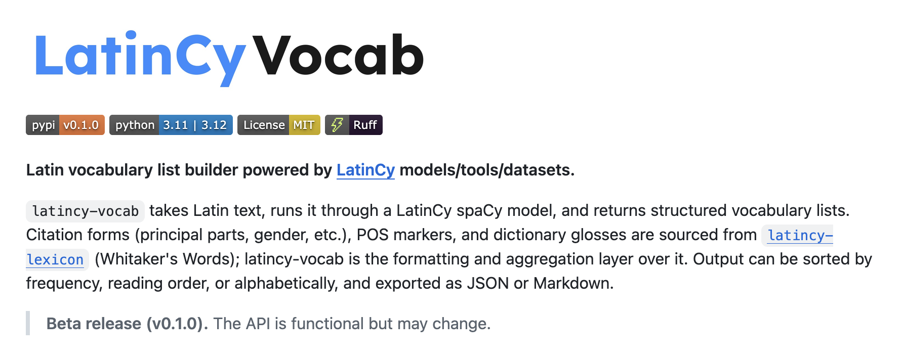
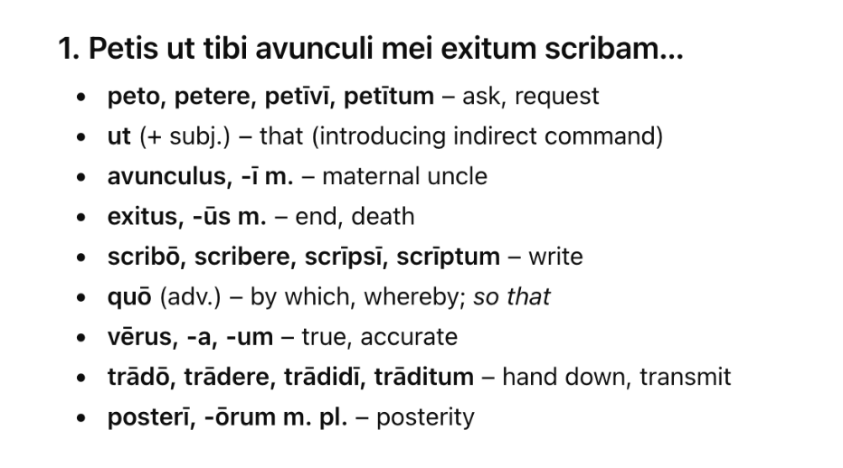

In two recent talks—one for the AP Latin class at [Fordham Prep](https://diyclassics.github.io/vocab-lists-fordham/) and the other for the [Hunter High School classics club](https://diyclassics.github.io/vocab-lists-hunter/)—I introduced students to the world of Latin natural language processing through the idea of automated vocabulary lists. The premise is as follows: What text analysis and formatting tools would we need to have in place to take a plaintext passage of Latin and extract the kind of vocabulary lists you might find in an introductory textbook or intermediate reader? So, not merely a brief gloss of each word, but a list that knows to express a verb with its principal parts and an adjective with its three genders, knows which words are specific to a passage and which are “core” vocabulary, and so on.

It is in the spirit of these talks that I developed [LatinCy Vocab](https://github.com/latincy/latincy-vocab) over the last few months. Vocab is a Python package and [spaCy](https://spacy.io/) component that wraps functionality from [LatinCy Pipelines](https://huggingface.co/latincy/la_core_web_lg), [LatinCy Lexicon](https://github.com/latincy/latincy-lexicon) (an NLP-aware refactoring of [Whitaker’s Words](https://mk270.github.io/whitakers-words/)), and related LatinCy resources together to accomplish the goal of turning plaintext Latin into a formatted vocabulary list. The package is available in a v0.1 beta release here: [https://pypi.org/project/latincy-vocab/](https://pypi.org/project/latincy-vocab/).

{#fig-latincy-vocab}

In the talks, I break down vocabulary list production into the following text tasks:

- tokenization
- lemmatization
- POS tagging
- lexical expansion, e.g., getting principal parts from any single instance of a verb
- lexical formatting, e.g., POS-aware presentations
- “keyness” measures
- named entity recognition
- word sense disambiguation (WSD)
- other considerations (e.g., macronization)

Let’s briefly summarize where LatinCy stands with respect to these kinds of tasks.

LatinCy Vocab combines the annotations from each of the projects noted above: the pipelines give us the main NLP annotations of tokens, lemmas, POS tags, even the named entities. Lexicon provides the glosses and the POS-aware expansions. Vocab then handles the pedagogical preparation by putting those two things together. Accordingly, this package knows how to make a Latin noun look like this in the vocabulary...

**verbum, -i**, *n.* word

and a Latin verb like this...

**dico, -ere, dixi, dictum**, *v.* to say

And a Latin adjective like this...

**bonus, -a, -um**, *adj.* good

and so on.

A nice addition to the package is the ability to filter vocabulary either by static word lists or by keyness measures. As for the first, for example, let’s say that you want to get only the vocabulary for a passage that is not covered by the [DCC Latin Core Vocabulary](https://dcc.dickinson.edu/latin-core-list1) list. You could pass that list of lemmas to the vocabulary builder. So, given the opening of [Pliny’s letter on Vesuvius](https://www.perseus.tufts.edu/hopper/text?doc=Plin.+Ep.+6.16), we keep *avunculus* ("uncle") in the vocab but drop *scribo* ("to write"). The package also allows us to pass more flexible and dynamically generated keyness measures. For example, we can pass a TF-IDF matrix for all of Pliny’s letters to the builder to ensure that a “key” word for Letter 6.16 like *pumex* ("pumice stone") is retained but less letter-specific words like *ut* ("as" *inter alia*) or *tibi* ("for you") are dropped.

Another item on the list above—specifically WSD—has good progress in the LatinCy world and should see a proper model and dataset release within the next few weeks. The importance of WSD—as discussed in my [talk at the Thesaurus Linguae Latinae](https://diyclassics.github.io/wsd/) last October—for vocabulary lists is obvious: while Whitaker’s Words (and so, LatinCy Lexicon) can provide general glosses for words, it would be far more helpful for readers to get context-specific glosses: thinking about Pliny’s letter again, a reader can orient themselves to the sense of the opening by understanding that the literal meaning of *exitus* is “a going out or forth, egress, departure” ([Lewis & Short literal sense I](https://www.perseus.tufts.edu/hopper/text?doc=Perseus%3Atext%3A1999.04.0059%3Aentry%3Dexitus2)) but they cannot really understand the passage until they know that the word here means “end of life, end, death” (L&S II.A.2). The best performing vocabulary list constructor should be able to handle that nuance. We are not there, but we are getting there.

In the high school talks, I present the idea of NLP-assisted vocabulary list generation as an example of what Jeannette Wing describes as ["computational thinking"](https://dl.acm.org/doi/10.1145/1118178.1118215). In her essay for *Communications of the ACM*, she defines one key aspect of computational thinking as "abstraction and decomposition when attacking a large complex task
or designing a large complex system" [@wing_2006_computational, 33]. This is precisely what we do when we break down the idea of vocabulary list generation into its requisite parts. Making a vocabulary list is in this sense like making a [peanut butter and jelly sandwich](https://pratt.duke.edu/news/learning-coding-pbjs/) [@kingery_2024_learning]: it will not come together until everyone takes the time to “think critically about each step of the ... creation process as well as the solutions to the obstacles ... encountered along the way.”

You may be tempted to ask in 2026—now more than three years into the [ChatGPT era](https://crossworks.holycross.edu/necj/vol51/iss1/3/)—why not just offload this whole complex, multistep process to an LLM. I would be the first to admit that it is not particularly difficult to prompt ChatGPT (or Claude or Gemini etc.) with something like “Make a well-formatted vocabulary list for this Latin passage,” with some Latin text appended (see @fig-llm-vocab). You will get a result, likely a perfectly passable result, maybe even a good one. But the scientific part of your philological and pedagogical brain should be asking questions like “How did the LLM come up with this list?” or “Why do I get a different list from very slightly different prompts?” And so on. Post prompt, we have a list. But we don’t have a good sense of how it came to be. Moreover, we don’t have a sense of where its weaknesses lie or even where it is flat-out wrong. In AI terms, with respect to vocabulary list generation, LLMs lack explainability and interpretability.

Here is Russell and Norvig [-@russell_2020_artificial, 711] on these topics: "We say that a machine learning model is interpretable if you can inspect the actual model and understand why it got a particular answer for a given input, and how the answer would change when the input changes. ... An explainable model is one that can help you understand 'why was this output produced for this input?'" It is critical as we redefine Latin pedagogy around computational affordances that we at the same time aspire to explainable philology, interpretable philology. This starts with being able to better explain what happens between a prompt and a response or between a Latin input and a Latin output. [Smaller language models](https://diyclassics.github.io/small-models/), in contrast to LLMs, can help us get there.

{#fig-llm-vocab}

The LatinCy Vocab lists, while—from my experience so far—quite good, also contain errors. That said, I can add that I know the error rates of each component in the NLP pipeline and have reported them for research transparency. I am constantly working on improving these scores over their current baselines. They may never reach 100% accuracy, but they will get better. If the models weren't explainable they also wouldn't be fixable, at least not in the same way. This kind of error analysis—and what is key, error correction being fed back into model training—is some of the most important work that we can do today in computational philology.

If you would like to learn more about the NLP underpinnings of automatic vocabulary list production, I will be hosting a workshop on the topic at this year’s annual meeting of the [Classical Association of the Atlantic States](https://caas-cw.org/category/2026-fall-meeting/) in Wilmington, DE this October. The workshop will help Latinists walk through each step of the process from tokenization and lemmatization to glossing for specific word senses, learning text analysis and natural language processing fundamentals, not to mention computational thinking fundamentals, along the way.
