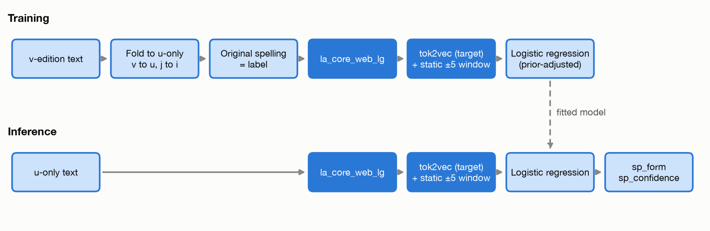
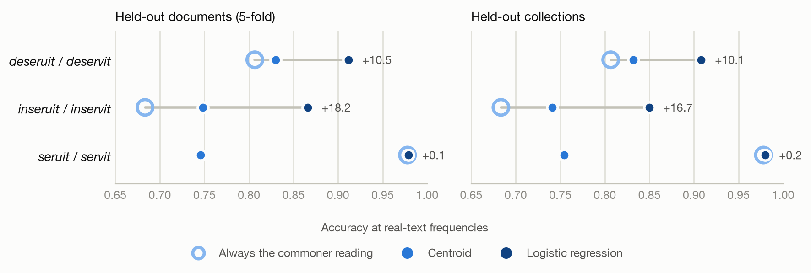

<!-- Claude skeleton: headings and asset slots only. All text is PJB's. -->

## The problem: u-only forms that spell two words

## Pairs and lemma groups

## Approach

## Results

## Limits

## Next steps
